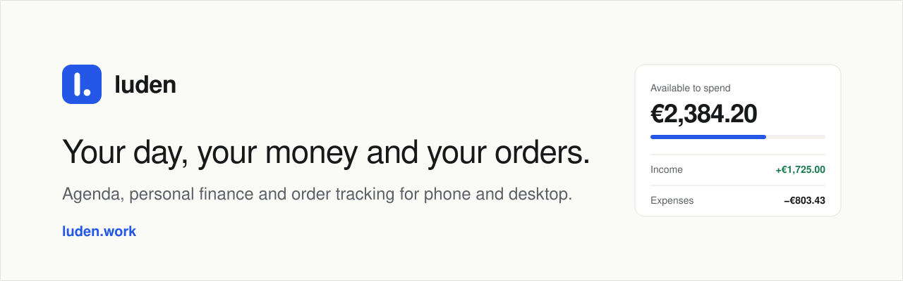

<p align="center">
  <a href="https://luden.work"></a>
</p>

<p align="center">
  <a href="https://luden.work">Website</a> ·
  <a href="https://luden.work/demo">Live demo</a> ·
  <a href="#español">Español</a>
</p>

luden is a web app for the everyday stuff: what you have to do today, how much money you actually have, and where each of your orders stands. It started as a personal tool and is now open for anyone to use.

It runs in the browser on your phone or computer and can be installed to the home screen. The interface is available in English and Spanish.

## What's in it

- **Today** shows the activity in progress with a countdown, what comes next and the rest of the day's tasks.
- **Agenda** holds your weekly routine and one-off plans. Changing a single day doesn't touch the rest of the week.
- **Money** covers accounts, transactions, transfers, spending limits per category, monthly savings and debts with partial payments.
- **Orders** tracks purchases you make for yourself, to resell or for friends: cost, sale, shipping, payment, refunds and exchanges, with a separate till so it never mixes with your personal balance.

Also: reminders before each activity, a daily debt reminder, an iPhone widget through Scriptable, Apple Pay expenses through Shortcuts, light and dark themes, and a full JSON export of your data.

## How it's built

Next.js 16 (App Router), React 19 and TypeScript on the front, Supabase Postgres for storage, deployed on Vercel.

The browser never queries the database directly. Every request goes through the app's API routes, which check a signed HttpOnly session cookie and only touch the tables of the signed-in profile. Passwords are hashed with scrypt and sign-in attempts are rate limited.

The demo at `/demo` runs entirely in the browser with sample data, so it's a safe way to look around.

## Running it locally

You need Node.js 20.9 or newer and a Supabase project.

```sh
git clone https://github.com/ludenelenterrador/luden.work.git
cd luden.work
npm ci
cp .env.example .env.local
npm run dev
```

Fill in `.env.local` with your own Supabase values. Without a database you can still open `http://localhost:3000/demo`.

The database schema lives in `supabase/`. Apply the files in this order with a privileged connection: `schema`, `shared-profile`, `savings-account`, `transfers`, `debts`, `day`, `day-plans`, `private-finance`, `day-changes`, `double-notifications`, `monthly-savings`, `finance-notifications`, `profiles`, `apple-pay-import`, `open-ended-tasks`, `management`, `management-phone-outside-cash`, `management-shipping-coherence`, `management-cash-edit`, `management-sync`, `management-collection-accounts` and `user-accounts`.

### Environment

| Variable | What it's for |
| --- | --- |
| `NEXT_PUBLIC_SUPABASE_URL`, `NEXT_PUBLIC_SUPABASE_ANON_KEY` | Public Supabase values, needed to build. |
| `SUPABASE_URL`, `SUPABASE_SERVICE_ROLE_KEY` | Server-side data access. |
| `SUPABASE_JWT_SECRET` | Signs the session cookie. Use a long random value. |
| `NEXT_PUBLIC_SITE_URL` | Canonical URL used in metadata. |
| `REGISTRATION_DISABLED` | Set to `1` to close sign-up. |
| `LEGACY_PROFILES`, `APP_PIN` | Optional PIN access for profiles created before accounts existed. |

### Checks

```sh
npm run lint
npm run build
npm test
```

More detail in [docs/DEVELOPMENT.md](docs/DEVELOPMENT.md). Feature notes are in [docs](docs/README.md).

---

## Español

luden es una app web para el día a día: qué tienes que hacer hoy, cuánto dinero tienes de verdad y en qué punto está cada pedido. Empezó como una herramienta personal y ahora cualquiera puede usarla.

Funciona en el navegador del móvil o del ordenador y se puede instalar en la pantalla de inicio. La interfaz está en español e inglés.

- **Hoy:** la actividad en curso con su cuenta atrás, lo siguiente y el resto de tareas del día.
- **Agenda:** tu rutina semanal y los planes puntuales. Cambiar un día no toca el resto de la semana.
- **Dinero:** cuentas, movimientos, traspasos, límites por categoría, ahorro por meses y deudas con pagos parciales.
- **Gestiones:** pedidos para ti, para revender o para amigos, con coste, venta, envío, cobro, reembolsos e intercambios, y una caja aparte.

Para probarla sin registrarte, entra en [luden.work/demo](https://luden.work/demo). Para ejecutarla en local, sigue los pasos de la sección en inglés y rellena `.env.local` con tu propio proyecto de Supabase.
