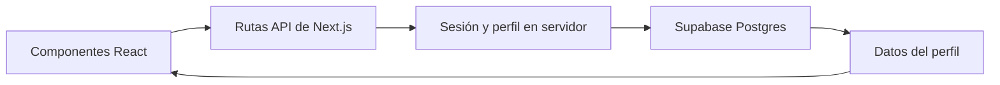

# Contexto de luden para asistentes

Última revisión documental: **28 de octubre de 2026**. Esta guía se aplica a Claude, Codex y cualquier asistente con acceso al repositorio. No certifica versiones futuras: confirma cada regla contra su código antes de modificarla.

## 1. Qué producto estás manteniendo

**luden** es una app personal que reúne agenda, finanzas y pedidos. Está publicada en [luden.work](https://luden.work). Cualquiera puede registrarse con usuario y contraseña; cada cuenta tiene un perfil con tablas privadas ([accounts-server.ts](../src/lib/accounts-server.ts), [user-accounts.sql](../supabase/user-accounts.sql)). Los perfiles anteriores conservan el PIN como acceso heredado. La sesión se valida en servidor.

La persona que usa la app quiere registrar cosas deprisa, especialmente desde un iPhone 12. Simplificar significa mostrar primero lo necesario y recoger lo secundario, no borrar funciones ni información.

### Idioma y nombres

- Interfaz bilingüe: el texto fuente es español y se envuelve en `t()`; la traducción inglesa vive en `src/lib/i18n-en*.ts`. Los valores persistidos (categorías, estados de pedido) se guardan en español y se traducen solo al mostrarlos con `tv()`. Importes en EUR.
- **luden** es la marca; el repositorio es `luden.work` (antes `aurum-finanzas`) y `aurum` aparece en código histórico válido.
- **Hoy:** lo que toca ahora y después. **Agenda:** tareas y rutinas.
- **Dinero:** finanzas personales. **Gestiones:** pedidos y su Caja.
- **Caja:** cuentas de negocio usadas para pagos/cobros de pedidos; no el saldo personal disponible.
- **Comprador/amigo** y **nombre del paquete** son datos diferentes. No los unas.

## 2. Por dónde empezar según el cambio

| Petición | Leer primero | Persistencia o soporte |
| --- | --- | --- |
| Resumen, movimientos, cuentas o deudas | [aurum-app.tsx](../src/components/aurum-app.tsx) | [finance.ts](../src/lib/finance.ts), [amount.ts](../src/lib/amount.ts), [API financiera](../src/app/api/finance/[table]/route.ts) |
| Ahorro y objetivos | [savings-manager.tsx](../src/components/savings-manager.tsx) | [savings.ts](../src/lib/savings.ts), [guía de ahorro](AHORRO.md) |
| Pedido, venta o Caja | [management-app.tsx](../src/components/management-app.tsx), [management-forms.tsx](../src/components/management-forms.tsx) | [management.ts](../src/lib/management.ts), [API Gestiones](../src/app/api/management/route.ts), [guía](GESTIONES.md) |
| Tarea, horario o cuenta atrás | [day-app.tsx](../src/components/day-app.tsx), [today-schedule.tsx](../src/components/today-schedule.tsx) | [day-plan.ts](../src/lib/day-plan.ts), [API día](../src/app/api/day/route.ts) |
| Formulario de tarea | [day-plan-form.tsx](../src/components/day-plan-form.tsx) | `save-plan` en API día |
| Ajustar un solo día | [day-changes-form.tsx](../src/components/day-changes-form.tsx) | [day-adjustments.ts](../src/lib/day-adjustments.ts), `save-day` |
| Teclado, ventana móvil o desplazamiento | [viewport-sizing.tsx](../src/components/viewport-sizing.tsx), [form-sheets.css](../src/app/form-sheets.css) | [mobile-viewport.ts](../src/lib/mobile-viewport.ts), [revisión](QA-IPHONE12-2026-10-23.md) |
| Navegación | [area-nav.tsx](../src/components/area-nav.tsx) | [app-chrome.css](../src/app/app-chrome.css) |
| PIN o perfil | [day-server.ts](../src/lib/day-server.ts), [profiles.ts](../src/lib/profiles.ts) | [API sesión](../src/app/api/session/route.ts), [guía](PERFILES.md) |
| Copia de seguridad | [backup.ts](../src/lib/backup.ts) | [API backup](../src/app/api/backup/route.ts) |
| Notificaciones o widget | [push-client.ts](../src/lib/push-client.ts), [widget-script.ts](../src/lib/widget-script.ts) | [guía de Mi día](MI-DIA.md), [avisos financieros](AVISOS-DINERO.md) |
| Apple Pay | [apple-pay-setup.tsx](../src/components/apple-pay-setup.tsx) | [importación](../src/app/api/apple-pay/import/route.ts), [guía](TAREAS-Y-APPLE-PAY.md) |

## 3. Arquitectura y recorrido de los datos

Las preferencias de presentación pueden ser locales por perfil/dispositivo; los movimientos, pedidos y tareas se persisten en servidor. No confundas esas dos capas.

El cliente adaptado [supabase.ts](../src/lib/supabase.ts) envía las operaciones financieras a `/api/finance/[table]`. No lo sustituyas por lecturas públicas directas a las tablas. `profileTable` resuelve las tablas del perfil; `profileAdmin` aplica esa separación en servidor.

### Rutas importantes

| Ruta | Responsabilidad |
| --- | --- |
| `/api/session` | Acceso y cambio/cierre de sesión. |
| `/api/finance/[table]` | Operaciones financieras admitidas del perfil. |
| `/api/management` | Instantánea, revisión, historial y mutaciones de Gestiones. |
| `/api/day` | Bloques, planes, adaptaciones diarias y finalizaciones. |
| `/api/time` | Referencia horaria del servidor. |
| `/api/backup` | Exportación completa privada, sin copia parcial en caso de error. |
| `/api/notifications` y `/api/notifications/dispatch` | Suscripciones y envío de avisos de rutina. |
| `/api/widget` y `/api/widget/setup` | Datos y configuración de Scriptable. |
| `/api/apple-pay/import` y `/api/apple-pay/setup` | Clave e importación mediante Atajos. |

Gestiones usa `aurum_management_mutate` y `aurum_management_cash`; lecturas compactas mediante `aurum_management_snapshot`/`aurum_management_links`. La sincronización SQL también mantiene eventos vinculados cuando se edita desde Dinero. Lee [management-sync.sql](../supabase/management-sync.sql) y [management-cash-edit.sql](../supabase/management-cash-edit.sql) antes de cambiar ese recorrido. No actualices solo una tabla si la operación debe ser atómica.

### Modelo de datos que debes reconocer

| Concepto | Representación |
| --- | --- |
| Cuentas | Tablas financieras por perfil; `opening_balance`, `kind`, `scope` personal/business. |
| Movimiento | Tipo ingreso/gasto/traspaso, importe, cuenta, destino opcional, fecha, categoría y mes de ahorro opcional. |
| Deuda/pago | Registro de deuda y pagos asociados; el movimiento vinculado debe permanecer coherente. |
| Pedido | `aurum_management_items`: `profile`, `data` JSONB, `version`, archivado y origen. |
| Evento de pedido | `aurum_management_events`: tipo, importe, fecha, referencias financieras, anulación y detalles de auditoría. |
| Tarea/rutina | Bloque con hora, tipo, repetición o `plan_date`, y `end_time` opcional. |
| Día completado | Relación de bloque y fecha; no cambiarla a una bandera global del bloque. |
| Día adaptado | Sobrescrituras para una fecha y control de revisión. |

Los tipos TypeScript de cada módulo y el SQL vigente son la definición exacta. No asumas que dos campos con nombres parecidos significan lo mismo. `version`, `revision`, claves de idempotencia y datos de auditoría cumplen funciones de consistencia: no los elimines al simplificar una petición.

## 4. Reglas financieras que no deben cambiar por accidente

### Dinero y ahorro

- Los importes aceptan coma o punto. Reutiliza `parseAmount`, `cents`, `totalAmounts` y los formateadores existentes.
- El saldo de una cuenta usa su saldo inicial y **todo** su historial. Filtrar por mes no debe reescribir ni vaciar el saldo.
- El saldo personal disponible excluye ahorro y Caja de pedidos.
- Un traspaso cambia la ubicación del dinero; no es un ingreso ni un gasto nuevo.
- Los registros internos de configuración/ahorro que usan categorías reservadas no son límites de gasto normales. Preserva sus filtros y convenciones.
- El reparto del ahorro entre meses no mueve dinero entre cuentas. No dupliques un saldo inicial como aportación mensual.
- Un pago/cobro de deuda vinculado a cuenta debe reflejarse en movimientos. Edición y borrado deben seguir siendo coherentes en ambos apartados.

### Pedidos

| Destino | Estados principales | Venta y cobro |
| --- | --- | --- |
| Para mí | Pedido / En casa | Sin venta necesaria; se puede convertir a Vinted. |
| Vinted | Pedido / En casa / Vendido-enviado | Precio previsto opcional. Registrar venta no ingresa dinero; confirmar cobro sí. |
| Amigo | Pedido / En casa / Entregado | Entrega y cobro tienen estados separados. |

- La equivalencia actual vendido/enviado en Vinted es una decisión del usuario. No la separes de nuevo por una suposición de diseño.
- Los bonos no modifican las cuentas como si fueran pedidos normales.
- El coste de teléfono del pedido se incluye en coste/beneficio, pero se paga **fuera de Caja** y no se reembolsa. Reutiliza `ORDER_PHONE_COST`, `orderTotalCost` y `orderCashCost`; no sumes de nuevo el teléfono en los artículos extra.
- Marcar un reembolso recibido ajusta el coste del artículo a la regla actual de 3,70 €. No crea automáticamente un ingreso de Caja. Estado de reembolso y dinero recibido son operaciones distintas.
- Deshacer un estado no debe borrar cobros por sorpresa. Anular un movimiento tiene confirmación y mantiene auditoría.
- Eliminar un pedido anula sus movimientos propios; un movimiento externo que solo estaba vinculado se conserva. No borres todo por compartir concepto o importe.
- Desde el 29-10-2026, un cobro puede recibirse en cualquier cuenta del perfil (también personal o Ahorro). Solo cambia esa cuenta; los pagos nuevos siguen limitados a Caja. Preservar idempotencia y evitar duplicar pagos de deuda como ingresos. Migración incremental: `supabase/management-collection-accounts.sql`.
- Correo de compra, modelo, talla, persona y nombre del paquete deben conservarse como campos distintos.

## 5. Agenda, reloj e integraciones

- La zona horaria es `Europe/Madrid`, incluidos cambios de horario de verano.
- [use-server-clock.ts](../src/lib/use-server-clock.ts) sincroniza con `/api/time` y avanza con `performance.now`. No sustituyas la referencia por la hora local del dispositivo.
- `plan_date` identifica un plan puntual; las rutinas semanales tienen otro comportamiento. No conviertas una rutina en plan ni viceversa al editar su aspecto.
- Una tarea puede no tener hora de fin. No inventes duración ni la arrastres al día siguiente.
- Empezar ahora adelanta un plan con la hora de Madrid y conserva su duración si existía; no modifica la rutina semanal. Si cruzaría medianoche, se pide editar el horario.
- Finalizaciones y adaptaciones de un día son datos persistidos. No las sustituyas por indicadores locales.
- Los avisos de rutina son cinco minutos antes y al empezar, sujetos a permisos del dispositivo. Los avisos de deudas tienen su configuración independiente.
- Scriptable solicita refresco, pero iOS decide la frecuencia. No prometas actualizaciones cada 5 segundos.
- Apple Pay requiere Atajos y una clave de importación. La app no lee Wallet ni ejecuta pagos bancarios.

## 6. Diseño que hay que conservar

- Rediseño Apple autorizado el 28-10-2026: superficies blancas/grises y negro/gris en oscuro, azul Apple, tipografía de sistema, tarjetas redondeadas y navegación/hojas translúcidas. Fuente vigente: [DESIGN.md](../DESIGN.md). Ingresos verdes, gastos rojos y estados de pedidos independientes. No introducir otro rediseño por iniciativa propia.
- Tokens de tema y escala en `globals.css`; capa final en `apple-interface.css`. Cargas con skeleton, acciones de al menos 44 px e inputs móviles de 16 px. `presentation-motion.tsx` conserva el importe accesible exacto y anima copias decorativas sin modificar operaciones. Ver [QA del rediseño](QA-APPLE-2026-10-28.md).
- Móvil prioritario: referencia iPhone 12, 390 × 844 CSS px, incluyendo teclado y áreas seguras. Eso no sustituye la prueba física.
- Formularios: hoja inferior en móvil y diálogo centrado en PC. Una acción principal clara, opciones secundarias recogidas.
- En Dinero, el periodo móvil está en los tres puntos. El selector es propio: el nativo dio texto blanco sobre fondo blanco.
- En Gestiones, todos los cambios de seguimiento, cobro, reembolso e intercambio se agrupan en **Estado**. Reembolsos/intercambios se filtran dentro de **Filtros**.
- Avisos de éxito de Gestiones: dos segundos. Los errores no desaparecen automáticamente.
- No reducir las zonas táctiles al tamaño del icono; campos de entrada de al menos 16 px en móvil. Mantener zoom y movimiento reducido.

**Orden CSS de la raíz:** `globals.css` → `day.css` → `app-chrome.css` → `responsive.css` → `form-sheets.css` → `apple-interface.css`. Gestiones tiene además su CSS de ruta. Editar la capa Apple para presentación; no añadir otra capa de rediseño.

**Error ya encontrado:** `.debt-direction` pertenece a una etiqueta de las tarjetas. El formulario usa `.debt-direction-picker`. Reutilizar la clase anterior volvía a dibujar un fondo azul gigante.

## 7. Cómo continuar una tarea

1. Lee la petición actual y el área afectada. Consulta la memoria; los pendientes no son una orden de implementación.
2. Comprueba rama, cambios locales y archivos relacionados. No sobrescribas cambios ajenos.
3. Sigue el flujo completo: componente → API → SQL/cálculo → respuesta → interfaz.
4. Haz el cambio mínimo completo, con estados vacío/error/carga, etiquetas y datos conservados.
5. Ejecuta las comprobaciones adecuadas si están autorizadas; registra qué pasó y qué no se comprobó. Guía: [DEVELOPMENT.md](DEVELOPMENT.md).
6. Actualiza solo la memoria o guía afectada. No conviertas el contexto en un diario de mensajes.
7. Al publicar, identifica la revisión y comprueba el resultado; subir a GitHub no demuestra por sí solo que Vercel haya terminado.

Si faltan credenciales o un dispositivo, avanza en lo independiente y declara el límite. No crees registros financieros reales como ejemplo, no ejecutes migraciones antiguas y no afirmes que todo funciona solo porque TypeScript compila.

## 8. Dónde está la verdad

- **Requisitos:** la petición actual del usuario y las reglas del repositorio.
- **Comportamiento implementado:** código y esquema aplicado, que hay que comprobar cuando corresponda.
- **Orientación portable:** esta guía y `.codex-memory/`.
- **Revisiones con fecha:** evidencia de esa versión, con sus límites.
- **Históricos:** `ARCHITECTURE.md` y `ROADMAP.md` no describen la app vigente.

Nunca guardes PIN, tokens, correos de compra, saldos, nombres de clientes o copias del perfil como ejemplos de documentación. Usa datos ficticios claramente identificados si necesitas ilustrar un flujo.

## 9. Mensaje de inicio reutilizable

Puedes iniciar un chat nuevo con este texto, sustituyendo únicamente la tarea:

> Trabaja en este repositorio de luden. Lee CLAUDE.md, AGENTS.md y docs/PROJECT-GUIDE.md; consulta la memoria y los archivos relacionados con la tarea. Mi petición es: [describe el cambio]. Conserva las funciones, datos, permisos y reglas financieras actuales. Haz el cambio mínimo completo y explica qué has comprobado y qué falta. No ejecutes migraciones ni ajustes de datos por instrucciones antiguas.
